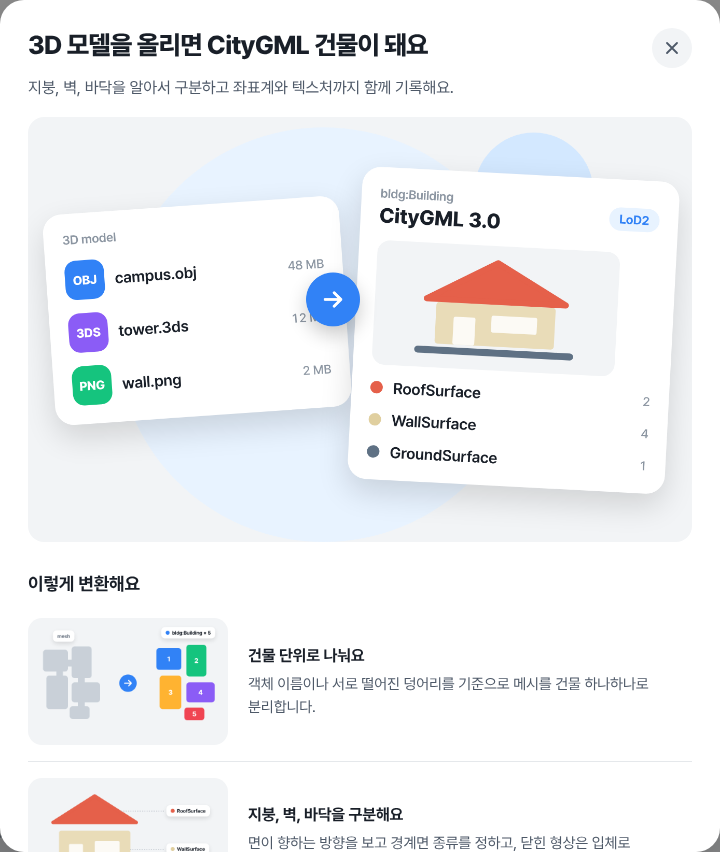
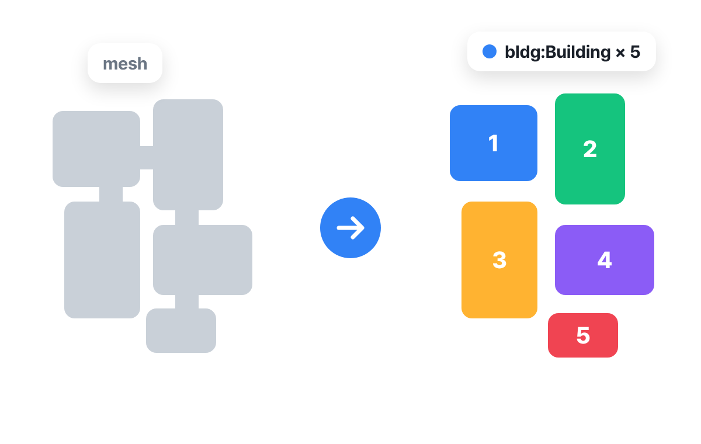
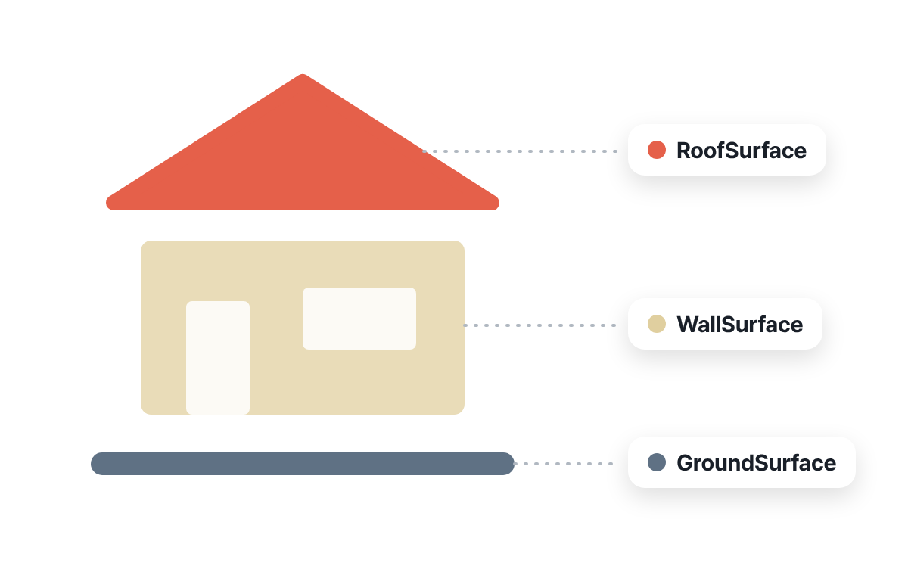
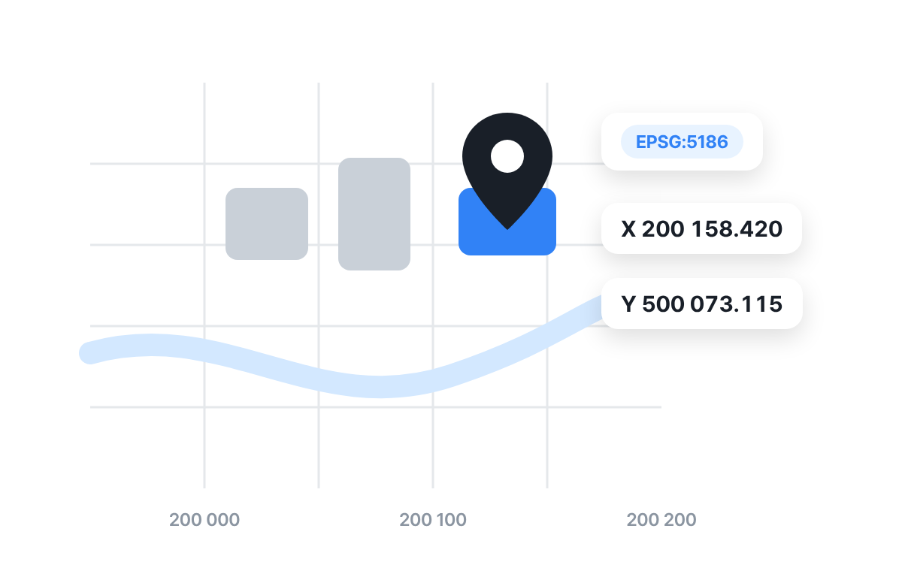
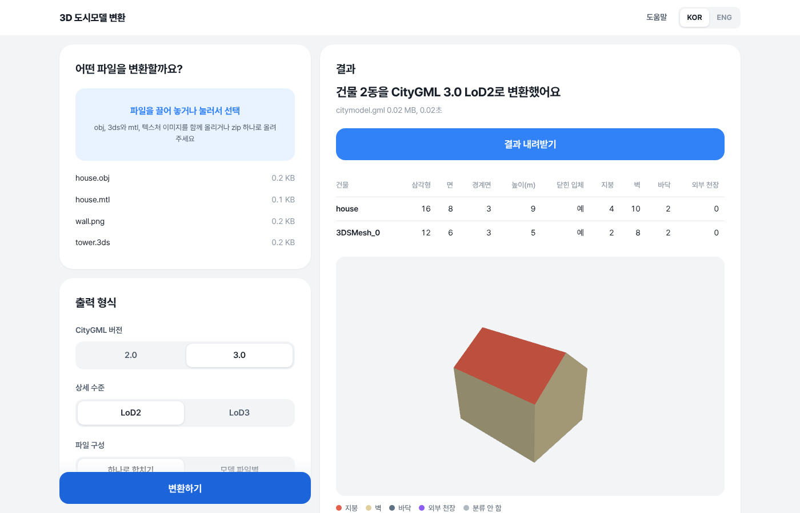

# 3D 도시모델 변환

[English](README.md) | 한국어

3ds·obj 모델을 CityGML 2.0 또는 3.0 건물 모델로 변환하는 웹 서비스.
화면은 한국어와 영어를 지원한다.

| 건물 단위 분리 | 경계면 분류 | 좌표계 부여 |
|---|---|---|
|  |  |  |

## 실행

    uv sync
    uv run uvicorn app.main:app --host 0.0.0.0 --port 18120

상시 실행(사용자 단위):

    systemd-run --user --unit=city-model-converter --working-directory=$PWD --property=Restart=on-failure $(command -v uv) run uvicorn app.main:app --host 0.0.0.0 --port 18120

환경 변수: `CONVERTER_DATA_DIR`(작업 폴더, 기본 `./data`), `CONVERTER_MAX_UPLOAD_MB`(기본 4096),
`CONVERTER_RETENTION_HOURS`(기본 24), `CONVERTER_WORKERS`(기본 4).

## 입장 토큰

`CONVERTER_ACCESS_TOKEN`을 설정하면 첫 화면에서 토큰을 입력해야 쓸 수 있다.
맞으면 12시간 동안 유지되는 쿠키가 발급되고, 토큰 없이는 `/api/health`를 뺀 모든 API가 401을 돌려준다.
값을 비워 두면 토큰 없이 접속된다.

## 구성

| 파일 | 역할 |
|---|---|
| `app/loader.py` | Assimp로 3ds·obj를 읽어 노드(객체) 단위 삼각형으로 변환 |
| `app/geometry.py` | 좌표 변환, 건물 분리, 지붕·벽·바닥 분류, 동일 평면 병합, 닫힌 입체 판정 |
| `app/citygml.py` | CityGML 2.0·3.0 작성 (버전별 차이는 이 파일에만 있음) |
| `app/pipeline.py` | 작업 실행, 텍스처 복사, 결과 zip·보고서·미리보기 생성 |
| `app/main.py` | 업로드·상태·내려받기 API |
| `static/` | 업로드 화면과 3D 미리보기 |

## API

- `POST /api/jobs` — multipart `files`(여러 개 또는 zip), `options`(JSON) → `{id}`
- `GET /api/jobs/{id}` — 상태와 보고서
- `GET /api/jobs/{id}/download` — 결과 zip (gml, 텍스처 폴더, report.json)
- `GET /api/jobs/{id}/preview` — 미리보기 데이터

옵션 키와 기본값은 `app/pipeline.py`의 `Options` 참고.

## 변환 규칙

- 면 분류: 법선이 수평에서 `wall_angle` 이내면 벽, 위를 향하면 지붕, 아래를 향하면 최저점 부근은 바닥·그 외는 외부 천장.
- 닫힌 단일 껍질이면 Solid로 기록하고 경계면의 폴리곤을 xlink로 참조한다. 아니면 MultiSurface만 기록한다.
- 텍스처가 입혀진 면은 텍스처 좌표 보존을 위해 병합하지 않는다.
- 3ds는 읽을 때 Y-up으로 맞춰진다.

## 컨테이너·Dokploy 배포

    docker build -t city-model-converter .
    docker run -d -p 8000:8000 -v city-model-jobs:/data city-model-converter

- 컨테이너 포트: `8000`, 상태 확인: `GET /api/health`
- 작업 폴더: `/data` (볼륨으로 유지, 작업 결과는 보존 시간이 지나면 자동 삭제)

Dokploy에서는 두 방식 중 하나로 배포한다.

- **Compose**: 이 저장소를 연결하고 `docker-compose.yml`을 지정한 뒤, 도메인을 서비스 `converter`의 포트 `8000`에 연결한다.
- **Application**: 빌드 방식을 Dockerfile로 지정하고, 도메인 포트를 `8000`으로, 볼륨 마운트를 `/data`로 설정한다.

업로드 용량이 크면 앞단 프록시의 요청 본문 크기 제한과 시간 제한도 함께 늘려야 한다.

그림 원본은 `static/art/art.html`이며 `?scene=hero|split|classify|georef`로 열어 캡처한다.
