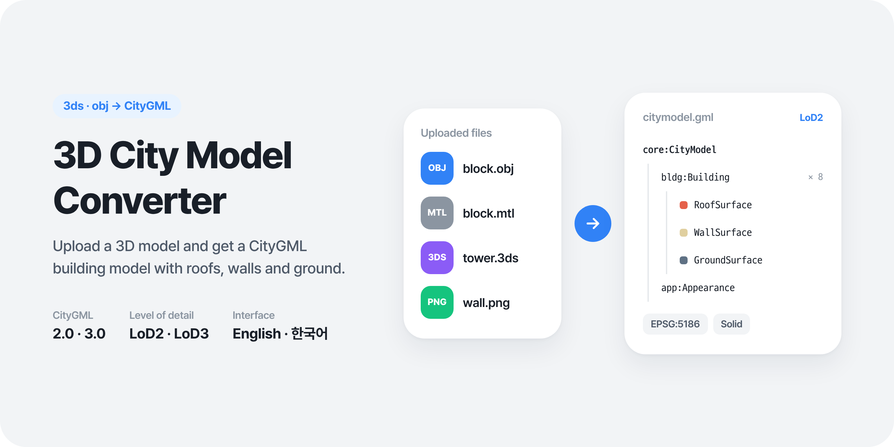
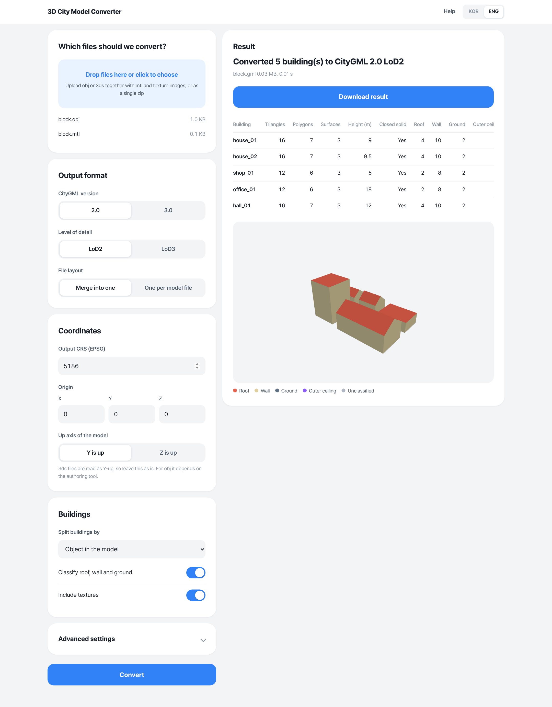
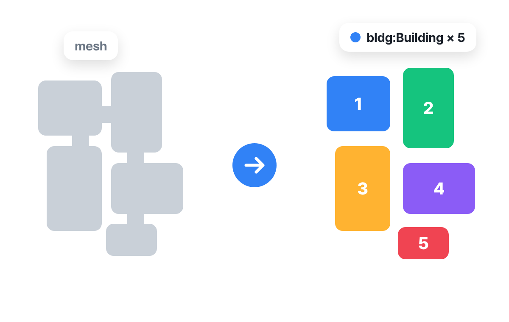
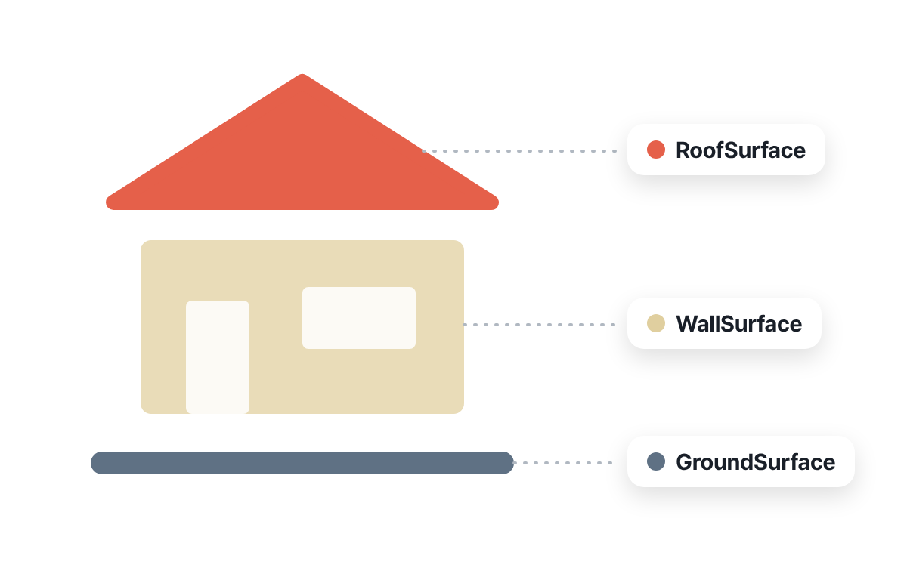
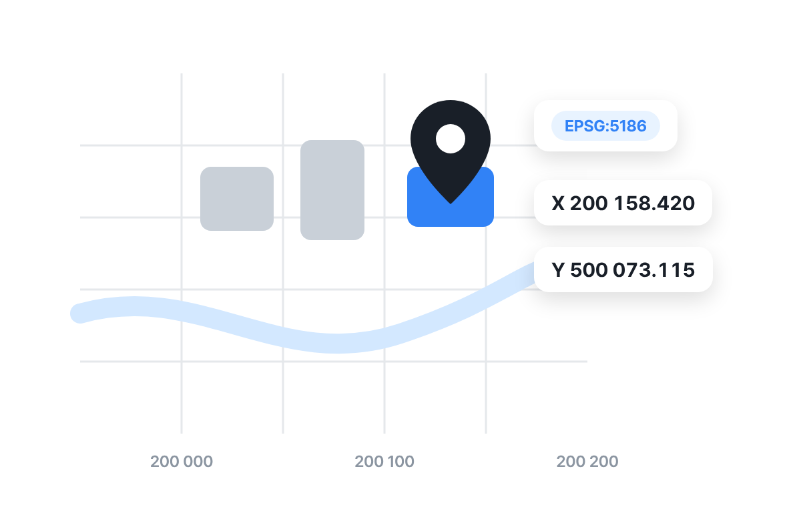

# 3D City Model Converter

English | [한국어](README.ko.md)

A web service that converts 3ds and obj models into CityGML 2.0 or 3.0 building models.
The interface is available in English and Korean.

## Screen

Five buildings in one obj converted to CityGML 2.0 LoD2. The result shows per-building counts and a 3D preview colored by surface type.

## How it converts

| Split into buildings | Classify surfaces | Georeference |
|---|---|---|
|  |  |  |

## Run

    uv sync
    uv run uvicorn app.main:app --host 0.0.0.0 --port 18120

Environment variables: `CONVERTER_DATA_DIR` (job folder, default `./data`), `CONVERTER_MAX_UPLOAD_MB` (default 4096),
`CONVERTER_RETENTION_HOURS` (default 24), `CONVERTER_WORKERS` (default 4).

## Access token

Set `CONVERTER_ACCESS_TOKEN` to ask for a token on the first screen.
A correct token issues a cookie that lasts 12 hours. Without it, every API except `/api/health` returns 401.
Leave it empty to allow access without a token.

## Layout

| File | Role |
|---|---|
| `app/loader.py` | Reads 3ds and obj with Assimp into triangles per node (object) |
| `app/geometry.py` | Coordinate transform, building split, roof/wall/ground classification, coplanar merge, closed-solid check |
| `app/citygml.py` | Writes CityGML 2.0 and 3.0 (all version differences live here) |
| `app/pipeline.py` | Runs a job, copies textures, builds the result zip, report and preview |
| `app/main.py` | Upload, status and download API |
| `static/` | Upload page and 3D preview |

## API

- `POST /api/jobs`: multipart `files` (several files or one zip) and `options` (JSON), returns `{id}`
- `GET /api/jobs/{id}`: job status and report
- `GET /api/jobs/{id}/download`: result zip (gml, texture folder, report.json)
- `GET /api/jobs/{id}/preview`: preview data
- `GET /api/health`: health check

Option keys and defaults are in `Options` in `app/pipeline.py`.

## Conversion rules

- Surface class: a face whose normal is within `wall_angle` of horizontal is a wall. Faces pointing up are roofs.
  Faces pointing down are ground near the lowest point and outer ceilings elsewhere.
- A single closed shell is written as a Solid that references the boundary surface polygons by xlink.
  Anything else is written as MultiSurface only.
- Textured faces are not merged, so their texture coordinates stay intact.
- 3ds files are read as Y-up.

## Container and Dokploy

    docker build -t city-model-converter .
    docker run -d -p 8000:8000 -v city-model-jobs:/data city-model-converter

- Container port: `8000`
- Job folder: `/data` (keep it on a volume; results are removed after the retention time)

Deploy on Dokploy in either of two ways.

- **Compose**: connect this repository, select `docker-compose.yml`, then route the domain to service `converter` on port `8000`.
- **Application**: build with the Dockerfile, set the domain port to `8000` and mount a volume at `/data`.

For large uploads, also raise the request body size and timeout limits of the proxy in front.

Illustrations are drawn in HTML and captured in a browser. The cover image comes from `docs/art/cover.html` (`?lang=ko|en`), the in-app illustrations from `static/art/art.html` (`?scene=hero|split|classify|georef`).
